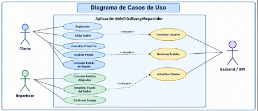

# Diagrama de Casos de Uso - App Delivery/Repartidor

## 1. Representación Visual

## 2. Actores

### Cliente

El cliente utiliza la aplicación para registrarse, iniciar sesión, realizar pedidos y consultar el estado de sus pedidos.

### Repartidor

El repartidor utiliza la aplicación para consultar pedidos asignados, actualizar estados y confirmar entregas.

### Backend / API

El sistema Backend recibe las solicitudes de la aplicación móvil y procesa la información.

## 3. Casos de Uso

### 1. Iniciar Sesión

Permite al cliente o repartidor ingresar al sistema utilizando sus credenciales.

### 2. Consultar Pedidos

Permite consultar los pedidos registrados o asignados.

### 3. Realizar Pedido

Permite al cliente registrar un nuevo pedido.

### 4. Actualizar Estado

Permite al repartidor cambiar el estado del pedido.

### 5. Confirmar Entrega

Permite registrar que el pedido fue entregado correctamente.