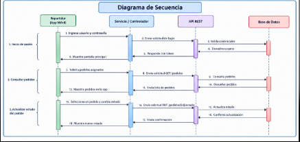

# Diagrama de Secuencia - Flujo Principal

## 1. Diagrama de Interacción

## 2. Explicación del Flujo

1. El repartidor inicia sesión.
2. La aplicación móvil envía las credenciales a la API.
3. La API valida las credenciales.
4. La API consulta la base de datos.
5. La base de datos devuelve la información.
6. La API devuelve un token de sesión.
7. El repartidor selecciona un pedido.
8. La aplicación envía una solicitud para actualizar el estado.
9. La API procesa la solicitud.
10. La base de datos guarda el nuevo estado.
11. La API devuelve una confirmación.
12. La aplicación muestra el nuevo estado.